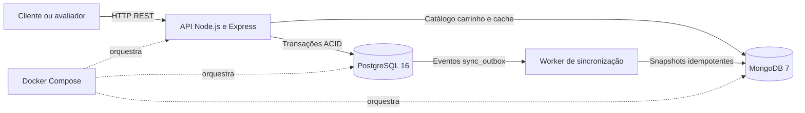
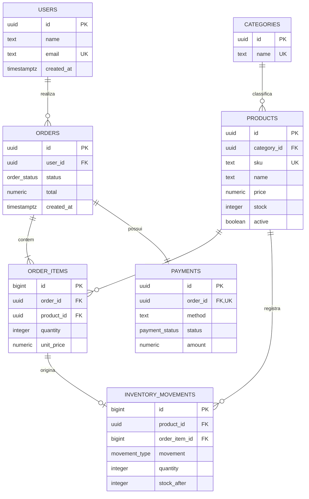
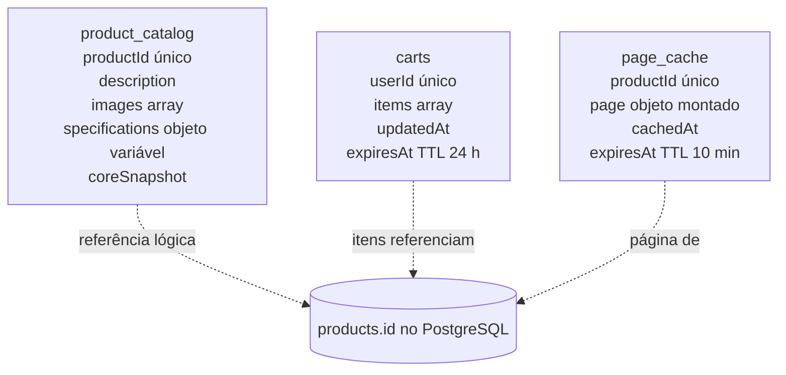

# Arquitetura e modelagem da persistência poliglota

## Objetivo e decisão principal

O sistema demonstra um e-commerce de alto tráfego que combina PostgreSQL e MongoDB. O PostgreSQL é a fonte da verdade para dados que exigem integridade transacional: usuários, produtos core, estoque, pedidos e pagamentos. O MongoDB atende dados semiestruturados e temporários: catálogo flexível, carrinhos e cache de páginas.

A API usa arquitetura em camadas. Controllers tratam HTTP, Services concentram regras de negócio e coordenam os bancos, e Repositories encapsulam os drivers `pg` e `mongodb`.

## Visão de contêineres



## Modelo relacional



`sync_outbox` é uma tabela técnica. Ela registra, na mesma transação que altera o produto, o snapshot que precisa ser enviado ao MongoDB.

### Normalização até a terceira forma normal

- Primeira forma normal: todos os campos relacionais são atômicos; os itens do pedido ficam em linhas separadas.
- Segunda forma normal: cada atributo depende integralmente da chave de sua tabela. O preço praticado pertence ao item do pedido, enquanto o preço vigente pertence ao produto.
- Terceira forma normal: dados de usuário, categoria, produto e pagamento não são repetidos em `orders`; as dependências transitivas são representadas por chaves estrangeiras.
- O total do pedido é mantido como snapshot financeiro deliberado. Ele preserva o valor confirmado e é validado pela função transacional.

### Regras críticas

- `create_order` cria pedido, itens e pagamento numa única transação.
- `trg_order_item_stock` faz uma atualização condicional atômica: o estoque só baixa quando há quantidade suficiente.
- Qualquer falha interrompe a função e o PostgreSQL desfaz todas as alterações.
- `vw_order_summary` consolida pedidos, clientes, itens e pagamentos para relatórios.
- `idx_orders_user_created_at` acelera o histórico de pedidos por usuário e data.

## Modelo de documentos



O catálogo usa documentos porque as especificações variam por categoria. Um celular pode ter RAM e armazenamento; uma camisa pode ter tamanho e material. Carrinhos e páginas em cache têm expiração automática por índices TTL.

Exemplo de catálogo:

```json
{
  "productId": "10000000-0000-0000-0000-000000000001",
  "description": "Smartphone com tela AMOLED e conectividade 5G.",
  "images": ["https://example.invalid/phone-front.jpg"],
  "specifications": {
    "ram": "8 GB",
    "storage": "128 GB",
    "color": "Preto"
  },
  "coreSnapshot": {
    "price": 1999.90,
    "stock": 25,
    "active": true
  }
}
```

## Fluxo Cache Aside

1. A API procura `page_cache` por `productId` e exige `expiresAt` no futuro.
2. Em cache miss, consulta preço e estoque no PostgreSQL e o catálogo no MongoDB.
3. Monta a página e grava o resultado com validade de dez minutos.
4. Atualizações de dados core ou catálogo invalidam a entrada correspondente.

## Fluxo Write Through e recuperação

1. A alteração de preço ou estoque é confirmada no PostgreSQL.
2. O trigger grava um evento em `sync_outbox` na mesma transação.
3. A API tenta propagar o snapshot imediatamente ao MongoDB.
4. Se o MongoDB estiver indisponível, o worker repete o evento com espera progressiva.
5. O `upsert` por `productId` torna a repetição idempotente e invalida o cache antigo.

Essa estratégia oferece consistência eventual com recuperação. PostgreSQL e MongoDB não compartilham uma transação distribuída; por isso não é correto prometer atomicidade global entre os dois bancos.

## Organização do código

```text
src/controllers     HTTP e códigos de resposta
src/services        regras de negócio e coordenação poliglota
src/repositories    consultas PostgreSQL e operações MongoDB
src/db              pools de conexão
sql                 DDL, DML, função, triggers, view e índices
mongo               coleções, validadores e índices TTL
scripts             povoamento, benchmark, carga e concorrência
```

## Métricas reproduzíveis

- `npm run seed`: garante pelo menos 100 mil pedidos e itens sintéticos.
- `npm run benchmark`: compara o histórico de pedidos sem e com índice usando `EXPLAIN ANALYZE`.
- `npm run load-test`: mede latência fria, percentis com cache aquecido e requisições por segundo.
- `scripts/demo-concorrencia.ps1`: envia duas compras simultâneas para a última unidade.
